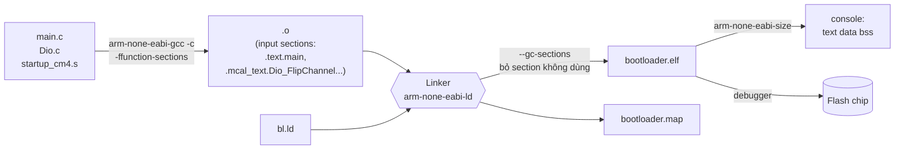
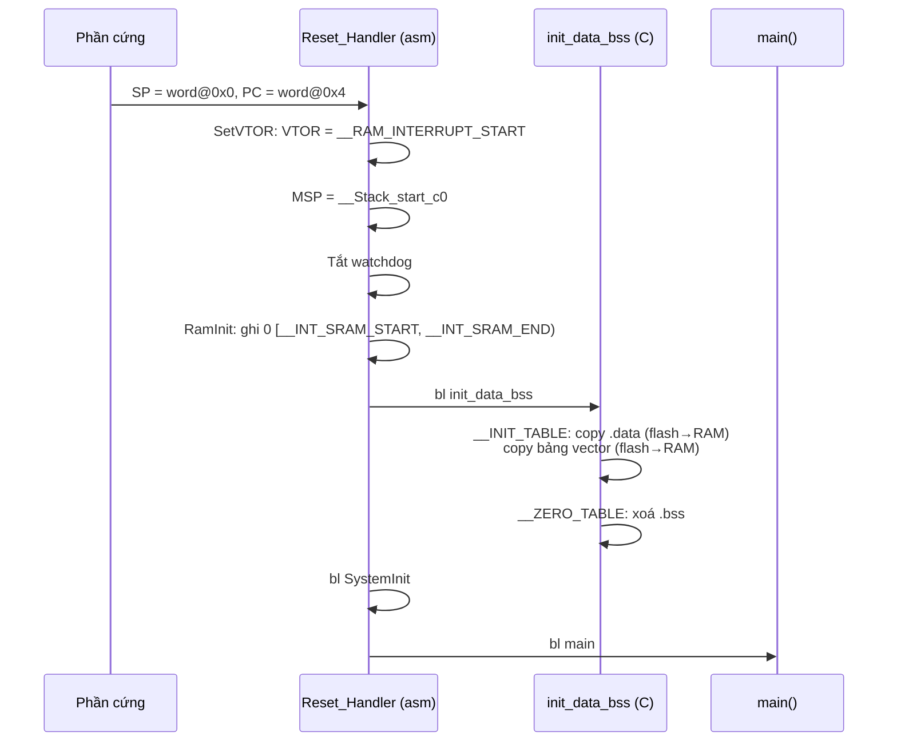
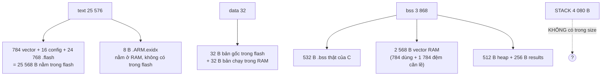

# Hướng dẫn linker script: hiểu và quản lý bộ nhớ S32K144 qua `bl.ld`

> **Dành cho:** dev embedded mới vào dự án. Bạn đã biết C và biết MCU là gì, nhưng chưa từng đọc linker script.
> **File học chính:** [`firmware/bootloader/Project_Settings/Linker_Files/bl.ld`](../../firmware/bootloader/Project_Settings/Linker_Files/bl.ld)
> **Số liệu lấy từ:** build `bootloader/Debug_FLASH` ở commit `11baba2` (nhánh `test/bootloader`, có `Test_LedBlink`). Khi build ở commit khác, địa chỉ và kích thước sẽ lệch đi, nhưng cách đọc thì không đổi.

## Học xong bạn làm được gì

1. Vẽ lại bản đồ bộ nhớ của chip, và chỉ ra BL, App, stack, cờ boot nằm ở đâu.
2. Với một hàm hoặc biến bất kỳ, trả lời được ba câu: **nó nằm ở đâu lúc nạp, nằm ở đâu lúc chạy, và ai copy hoặc xoá nó**.
3. Đọc file `.map` để tìm địa chỉ và kích thước, và **đối chiếu với số `text/data/bss` in ra trên console khi build**.
4. Sửa linker script an toàn, rồi tự kiểm chứng kết quả.
5. Tự chẩn đoán hai lỗi thật đã gặp trong dự án.

## Lộ trình


Chương 1 đến 4 là bức tranh tổng thể, chương 5 đến 8 mổ xẻ từng dòng, chương 9 đến 12 là kỹ năng dùng hằng ngày.

### Bốn "nhân vật" theo suốt tài liệu

Thay vì học cú pháp suông, ta theo dấu 4 thứ có thật trong firmware, từ file `.c` tới địa chỉ trên chip:

| Nhân vật | Loại | Ví dụ thật |
|---|---|---|
| 🟦 **Hàm** | code | `Dio_FlipChannel` (RTD), `Test_LedBlink` (`src/main.c`) |
| 🟩 **Hằng** | `const` | `Port_Config` (`mcal_cfg/src/Port_PBcfg.c`) |
| 🟨 **Biến có giá trị đầu** | `.data` | `GpioBaseAdresses` (`Gpio_Dio_Ip.c`) |
| 🟥 **Biến không khởi tạo** | `.bss` | `Clock_Ip_pxConfig` (`Clock_Ip.c`) |
| ⬛ **Cờ boot** | noinit | `.boot_noinit` (`Boot_Shared.h`) |

Chương nào cũng quay lại hỏi: "4 nhân vật này đang ở đâu?"

---

## Chương 1. Vì sao cần linker script?

Compiler dịch từng file `.c` riêng lẻ thành file `.o`. Lúc đó nó **chưa biết** hàm sẽ nằm ở địa chỉ nào; nó chỉ đóng code và dữ liệu thành các **"thùng hàng"**, gọi là *input section*: `.text`, `.data`, `.bss`...

Linker là người **xếp các thùng hàng vào kho**. Để xếp được, nó cần một bản hướng dẫn trả lời 3 câu hỏi:

| Câu hỏi | Phần trả lời trong `bl.ld` |
|---|---|
| Chip có những vùng nhớ nào, bắt đầu ở đâu, dài bao nhiêu? | Khối `MEMORY` ("lô đất") |
| Thùng hàng nào đặt vào vùng nào, theo thứ tự nào? | Khối `SECTIONS` ("bản xếp đồ") |
| Startup cần biết những địa chỉ nào để dựng RAM trước khi vào `main`? | Các **symbol** cuối file ("hợp đồng") |

> **Ghi nhớ:** linker script không chạy trên chip. Nó chỉ quyết định địa chỉ lúc build. Cái thực sự chạy là code startup, và code đó dùng các địa chỉ mà linker script tính ra.

---

## Chương 2. Bộ nhớ của S32K144 (phần cứng)

### 2.1 Bản đồ toàn chip và cách dự án chia

```
 Địa chỉ          ┌──────────────────────────────┐
 0x0000_0000      │ BL: bảng vector (1 KB)       │ ┐
 0x0000_0400      │ Flash Configuration Field 16B│ │  BOOTLOADER
 0x0000_0410      │ BL: code + hằng (~127 KB)    │ │  (bl.ld)
 0x0001_FFFF      ├──────────────────────────────┤ ┘
 0x0002_0000      │ App: vector + code           │ ┐  APPLICATION
                  │                              │ │  (app.ld)
 0x0007_EFFF      ├──────────────────────────────┤ ┘
 0x0007_F000      │ Metadata (FBL ghi, 4 KB)     │    không link
 0x0007_FFFF      └──────────────────────────────┘
                        P-Flash 512 KB, sector 4 KB

                  ┌──────────────────────────────┐
 0x1FFF_8000      │ SRAM_L (32 KB)               │
 0x1FFF_FFFF      ├ - - - - - - - - - - - - - - -┤  hai khối liền nhau
 0x2000_0000      │ SRAM_U (28 KB)               │  → linker coi là 1 vùng
 0x2000_6FFF      └──────────────────────────────┘
                        SRAM 60 KB, có ECC
```

> Dải SRAM mà linker dùng là 0x1FFF_8000–0x2000_6FFF, tức 60 KB. Datasheet có thể ghi một con số tổng khác, vì nó tính cả FlexRAM, là vùng mà dự án không dùng làm RAM thường. Khi cần, đối chiếu với Reference Manual, mục *Memory map*.

### 2.2 Ba sự thật phần cứng mà linker script phải tôn trọng

1. **Cortex-M4 khởi động từ địa chỉ 0.** Phần cứng đọc word ở `0x0` làm giá trị đầu của stack pointer, và word ở `0x4` làm địa chỉ `Reset_Handler`. Vì vậy bảng vector **bắt buộc** nằm ở 0x0. Thanh ghi `VTOR` cho phép sau đó chuyển bảng vector sang chỗ khác.
2. **Flash Configuration Field (0x400–0x40F)** chứa các byte bảo mật `FSEC` và `FOPT`. Startup của RTD ghi `0xFFFF7FFE`, trong đó `FSEC = 0xFE` nghĩa là **không khoá chip**. Ghi sai các byte này có thể khiến chip bị khoá, debugger không kết nối được nữa. Vì thế đây là 16 byte "cấm động vào" (BL_SRS_012).
3. **SRAM có ECC.** Đọc một ô SRAM chưa từng được ghi sau khi bật nguồn có thể gây lỗi ECC. Vì thế startup phải ghi 0 lên toàn bộ RAM trước khi dùng; bước này tên là `RamInit`.

---

## Chương 3. Từ `.c` đến `.elf`: pipeline build trong S32DS



### 3.1 S32DS lấy linker script ở đâu

Trong `firmware/bootloader/.cproject`, mục *C Linker → General*:

```xml
<listOptionValue value="&quot;${ProjDirPath}/Project_Settings/Linker_Files/bl.ld&quot;" />
```

Hai cờ có ảnh hưởng trực tiếp tới linker:

| Cờ | Tác dụng |
|---|---|
| `-ffunction-sections` (compiler) | Mỗi hàm và mỗi biến có section riêng: `.text.main`, `.mcal_text.Dio_FlipChannel`... |
| `--gc-sections` (linker) | Bỏ mọi section không ai tham chiếu tới. Kết hợp với cờ trên thì bỏ được từng hàm thừa. |

### 3.2 Tên thùng hàng đến từ đâu

- Code C thường: compiler dùng tên mặc định `.text`, `.rodata`, `.data`, `.bss`.
- Code RTD (MCAL): đặt tên qua cơ chế **MemMap**. Ví dụ trong `Dio.c`:

  ```c
  #define DIO_START_SEC_CODE
  #include "Dio_MemMap.h"      /* → #pragma GCC section text ".mcal_text" */
  ... các hàm Dio ...
  #define DIO_STOP_SEC_CODE
  #include "Dio_MemMap.h"
  ```

  Vì vậy code MCAL nằm trong `.mcal_text`, hằng cấu hình nằm trong `.mcal_const_cfg`, biến nằm trong `.mcal_data` và `.mcal_bss`.
- Khi bật `-ffunction-sections`, compiler thêm **hậu tố tên hàm**: `.mcal_text` → `.mcal_text.Dio_FlipChannel`. Hậu tố này là nguyên nhân của case study ở chương 9.4.

> **Hay nhầm:** debugger chỉ nạp những section có **địa chỉ nạp (LMA) nằm trong flash**. RAM không được nạp sẵn mà được startup dựng lại mỗi lần reset (chương 7).

---

## Chương 4. Bố cục tổng thể của `bl.ld`

| Khối | Dòng | Vai trò | Chương |
|---|---|---|---|
| Header + comment bản đồ bộ nhớ | 1–34 | Tóm tắt cách chia bộ nhớ của dự án | 2 |
| `MEMORY` | 37–47 | Khai báo các lô đất | 5 |
| `HEAP_SIZE`, `ENTRY` | 50–52 | Tham số, điểm vào | 5.3 |
| `SECTIONS`, phần flash | 57–124 | Vector, flash config, code, hằng | 6 |
| `SECTIONS`, phần RAM | 126–222 | exidx, vector RAM, data, bss, code Fls, heap, results, noinit | 7 |
| Symbol cho startup | 224–264 | Hợp đồng với `startup_cm4.s` và `startup.c` | 8 |

### 4.1 Cú pháp tối thiểu (chỉ những gì `bl.ld` dùng)

| Cú pháp | Nghĩa | Ví dụ trong file |
|---|---|---|
| `NAME : ORIGIN = a, LENGTH = n` | Khai báo một region trong `MEMORY` | `int_flash : ORIGIN = 0x410, ...` |
| `.out : { ... } > region` | Tạo output section và đặt nó vào region | `.flash : {...} > int_flash` |
| `*(.x)` | Gom input section **tên đúng** `.x` từ mọi file `.o` | `*(.mcal_text)` |
| `*(.x.*)` | Gom các section `.x.<gì đó>` | `*(.mcal_text.*)` |
| `*(.x*)` | Gom mọi tên bắt đầu bằng `.x` | `*(.text*)` |
| `.` | Location counter: địa chỉ hiện tại | `__data_ram_start = .;` |
| `ALIGN(n)` | Nhảy `.` lên bội số tiếp theo của n | `. = ALIGN(4);` |
| `. += n` | Chừa trống n byte | `. += HEAP_SIZE;` |
| `KEEP(...)` | Cấm `--gc-sections` bỏ section này | `KEEP(*(.intc_vector))` |
| `AT(addr)` | Đặt **địa chỉ nạp** (LMA) khác địa chỉ chạy | `.sram_data : AT(__DATA_ROM)` |
| `(NOLOAD)` | Section chỉ chiếm chỗ, không có nội dung trong file nạp | `.sram_bss (NOLOAD)` |
| `sym = expr;` | Tạo symbol (một địa chỉ) mà code C hoặc asm dùng được | `__Stack_start_c0 = ...` |
| `PROVIDE(sym = ...)` | Chỉ tạo symbol nếu code chưa định nghĩa nó | `PROVIDE(__exidx_start = .)` |
| `ORIGIN(r)`, `LENGTH(r)`, `ADDR(s)`, `DEFINED(s)` | Hàm tra cứu | `ORIGIN(int_sram_noinit)` |

> **Hay nhầm:** `*(.text)` **không** khớp `.text.main`. Mỗi dạng tên cần pattern riêng. Lỗi ở chương 9.4 sinh ra từ đúng điểm này.

---

## Chương 5. Khối `MEMORY`: chia lô đất

```ld
MEMORY
{
    int_flash_interrupts : ORIGIN = 0x00000000, LENGTH = 0x00000400  /* 1K */
    int_flash_config     : ORIGIN = 0x00000400, LENGTH = 0x00000010  /* 16 bytes */
    int_flash            : ORIGIN = 0x00000410, LENGTH = 0x0001FBF0  /* ~127KB, ends at 0x0001FFFF */
    int_sram_results     : ORIGIN = 0x1FFF8000, LENGTH = 0x00000100  /* 256 bytes */
    int_sram             : ORIGIN = 0x1FFF8100, LENGTH = 0x0000DF00  /* ~56K */
    int_sram_stack_c0    : ORIGIN = 0x20006000, LENGTH = 0x00000FF0  /* 4K - 16 bytes */
    int_sram_noinit      : ORIGIN = 0x20006FF0, LENGTH = 0x00000010  /* 16 bytes boot request */
    ram_rsvd2            : ORIGIN = 0x20007000, LENGTH = 0           /* End of SRAM */
}
```

### 5.1 Bảng region

| Region | Bắt đầu | Kết thúc | Kích thước | Lý do |
|---|---|---|---|---|
| `int_flash_interrupts` | 0x0000_0000 | 0x0000_03FF | 1 KB | Phần cứng đọc vector từ 0x0 |
| `int_flash_config` | 0x0000_0400 | 0x0000_040F | 16 B | Vị trí cố định của Flash Config Field |
| `int_flash` | 0x0000_0410 | 0x0001_FFFF | 127 KB − 16 B | Dừng đúng ở ranh giới BL/App |
| `int_sram_results` | 0x1FFF_8000 | 0x1FFF_80FF | 256 B | Vùng kết quả của RTD |
| `int_sram` | 0x1FFF_8100 | 0x2000_5FFF | 55,75 KB | data, bss, vector RAM, heap |
| `int_sram_stack_c0` | 0x2000_6000 | 0x2000_6FEF | 4 KB − 16 B | Stack |
| `int_sram_noinit` | 0x2000_6FF0 | 0x2000_6FFF | 16 B | Cờ boot dùng chung App↔BL |
| `ram_rsvd2` | 0x2000_7000 | — | 0 | Chỉ là mốc đánh dấu hết SRAM |

### 5.2 Tính thử con số `0x1FBF0`

```
  Ranh giới App        0x0002_0000
− Điểm bắt đầu         0x0000_0410
= Chiều dài int_flash  0x0001_FBF0   → kết thúc ở 0x0001_FFFF
```

Muốn BL to hơn thì phải dời ranh giới App. Khi đó phải sửa **cùng lúc** `bl.ld`, `app.ld` và địa chỉ nhảy trong Boot Manager (chương 11).

> **Hay nhầm:** region chỉ là **giới hạn**, không tự chứa gì cả. Region trống nếu không section nào được đặt vào bằng `> region`. Linker báo lỗi `will not fit in region` khi các section đặt vào một region vượt quá `LENGTH` của nó.

> **Vì sao `bl.ld` không khai báo vùng App?** BL không chứa code của App. Vùng 0x20000 trở đi do FBL ghi lúc chạy, nên linker của BL không được đặt gì vào đó.

### 5.3 `HEAP_SIZE` và `ENTRY`

```ld
HEAP_SIZE  = DEFINED(__heap_size__)  ? __heap_size__  : 0x00000200;
ENTRY(Reset_Handler)
```

- Heap mặc định 512 B. Có thể ghi đè bằng cờ linker `--defsym=__heap_size__=0x400`.
- `ENTRY` cho debugger và cho file `.elf` biết điểm vào là `Reset_Handler`. Trên chip thật, điểm vào được quyết định bởi word ở 0x4 của bảng vector.

---

## Chương 6. Khối `SECTIONS`, phần flash

Mỗi output section được giải thích theo 4 câu: **gom gì, đặt vào đâu, vì sao theo thứ tự này, ai dùng nó**.

### 6.1 `.flash_interrupts`: bảng vector

```ld
.flash_interrupts :
{
    . = ALIGN(2048);
    __interrupts_rom_start = .;
    KEEP(*(.intc_vector))
    . = ALIGN(4);
    __interrupts_rom_end = .;
} > int_flash_interrupts
```

- **Gom:** section `.intc_vector` do `Vector_Table.s` của RTD sinh ra.
- **Vì sao cần `KEEP`:** không có code nào "gọi" bảng vector, nên nếu thiếu `KEEP` thì `--gc-sections` sẽ coi nó là rác và bỏ đi. Khi đó chip không có Reset vector và **không chạy**.
- **Số thật:** 0x310 = 784 B (16 vector lõi + các vector ngắt ngoại vi), nằm ở 0x0000_0000. Phần từ 0x310 tới 0x3FF bỏ trống.

### 6.2 `.flash_config`: 16 byte cấm động vào

```ld
.flash_config : { KEEP(*(.flash_config)) } > int_flash_config
```

- **Nội dung** (`startup_cm4.s`): `0xFFFFFFFF ×3`, sau đó là `0xFFFF7FFE`, trong đó byte cuối là `FSEC = 0xFE`, nghĩa là không khoá chip.
- Chỉ BL được chứa section này. `app.ld` bỏ nó bằng `/DISCARD/ : { *(.flash_config) }`, nếu không thì linker của App sẽ đặt section này vào giữa vùng code của App.

### 6.3 `.flash`: code và hằng

Thứ tự gom, từ địa chỉ thấp lên cao:

```
0x0410 ┌─────────────────────────────┐
       │ .startup       (Reset_Handler, asm)
       │ .systeminit
       │ .text.startup
       │ .text, .text*  ← 🟦 Test_LedBlink @ 0x0AF4
       │ .mcal_text, .mcal_text.*  ← 🟦 Dio_FlipChannel @ 0x0D60
       │ acfls_code_rom_start
       │   .acfls_code_rom*, .acmem_43_INFLS_code_rom*   (code ghi flash, sẽ copy ra RAM)
       │ acfls_code_rom_end
       │ .init, .fini
       │ .rodata, .rodata*
       │ .mcal_const_cfg*  ← 🟩 Port_Config @ 0x5CF0
       │ .mcal_const*, .mcal_const_no_cacheable*
       │ __init_table  @ 0x64A8   (bảng copy cho startup)
       │ __zero_table             (bảng xoá cho startup)
       │ .acmcu_code_rom*
0x64D0 │ _etext = __DATA_ROM      ← bản gốc của .data bắt đầu ở đây
       └─────────────────────────────┘
```

- **Vì sao mỗi loại có cả `*(.x)` và `*(.x.*)`:** để gom được cả khi tắt lẫn khi bật `-ffunction-sections` (chương 9.4).
- **Vì sao `__DATA_ROM` ở cuối:** ngay sau `.flash`, linker đặt **bản gốc** của các biến `.data`. Startup sẽ copy bản gốc này ra RAM (chương 7).
- **Số thật:** `.flash` dài 0x60C0 = 24 768 B, bắt đầu ở 0x410.

---

## Chương 7. Khối `SECTIONS`, phần RAM: LMA và VMA

Đây là chương **quan trọng nhất**. Hãy đọc chậm.

### 7.1 Một biến, hai địa chỉ

Xét 🟨 `GpioBaseAdresses`, một mảng có giá trị đầu. Khi chạy, mảng này phải nằm trong RAM để ghi được. Nhưng RAM mất sạch khi tắt nguồn, vậy **giá trị đầu được cất ở đâu?** Câu trả lời là trong flash.

- **VMA** (Virtual/Run address): địa chỉ mà code dùng khi chạy, nằm trong RAM.
- **LMA** (Load address): địa chỉ cất bản gốc, nằm trong flash.

```
        FLASH (giữ khi mất nguồn)                    SRAM (mất khi mất nguồn)
   ┌──────────────────────────┐               ┌──────────────────────────┐
   │ .flash  code + hằng      │               │                          │
   │ ...                      │   startup     │                          │
   │ 0x64D0 ┌───────────────┐ │   copy 32 B   │ 0x1FFF8B10 ┌───────────┐ │
   │  LMA   │ bản gốc .data │─┼──────────────►│  VMA       │ .data     │ │ ← code đọc/ghi ở đây
   │ 0x64F0 └───────────────┘ │ init_data_bss │ 0x1FFF8B30 ├───────────┤ │
   └──────────────────────────┘               │            │ .bss      │ │ ← startup ghi 0
                                              │ 0x1FFF8D44 └───────────┘ │
                                              └──────────────────────────┘
```

Trong `.map`, dòng mở đầu section hiện **cả hai** địa chỉ:

```
.sram_data      0x1fff8b10       0x20 load address 0x000064d0
                ^VMA             ^size              ^LMA
```

### 7.2 Thứ tự các section trong RAM (số thật)

```
0x1FFF8000 ┌──────────────────────────────┐ int_sram_results
           │ int_results       256 B      │ (RTD)
0x1FFF8100 ├──────────────────────────────┤ int_sram
           │ .ARM.exidx        8 B        │
0x1FFF8108 │ *fill*            0x6F8 B    │ ← phí do ALIGN(2048)
0x1FFF8800 │ .sram_interrupts  0x310 B    │ bảng vector bản RAM (VTOR trỏ vào đây)
0x1FFF8B10 │ .sram_data        32 B   🟨  │ copy từ flash 0x64D0
0x1FFF8B30 │ .sram_bss         532 B  🟥  │ xoá về 0
0x1FFF8D44 │ .acfls_code_ram   0 B        │ (Fls chưa dùng)
0x1FFF8D44 │ .heap             512 B      │
0x1FFF8F44 │                              │
           │   ... trống ~53,4 KB ...     │
0x20006000 ├──────────────────────────────┤ int_sram_stack_c0
           │ stack 4080 B (lớn dần ↓)     │ SP đầu = 0x20006FF0
0x20006FF0 ├──────────────────────────────┤ int_sram_noinit
           │ .boot_noinit      16 B   ⬛  │ RamInit KHÔNG xoá
0x20007000 └──────────────────────────────┘
```

### 7.3 Từng section

**`.sram_interrupts`: chừa chỗ cho bảng vector trên RAM**

```ld
.sram_interrupts :
{
    . = ALIGN(2048);
    __interrupts_ram_start = .;
    . += (__interrupts_rom_end - __interrupts_rom_start);
    ...
} > int_sram
```

- Section này không có nội dung, chỉ chừa đúng bằng kích thước bảng trên flash (0x310). Startup copy bảng vector sang đây rồi trỏ `VTOR` vào. Nhờ vậy driver có thể đổi handler ngắt lúc chạy (RTD bật `USE_SW_VECTOR_MODE`).
- **Hay nhầm:** `objdump` báo section dài 0xA08 = 2568 B, trong khi bảng chỉ 0x310 = 784 B. 0x6F8 = 1784 B còn lại là phần đệm (`*fill*`) để nhảy từ 0x1FFF8108 lên bội số của 2048 là 0x1FFF8800. Lý do phải căn: `VTOR` yêu cầu địa chỉ bảng căn theo lũy thừa của 2 lớn hơn hoặc bằng kích thước bảng. Với bảng 784 B thì tối thiểu là 1024; RTD chọn 2048 cho an toàn.

**`.sram_data AT(__DATA_ROM)`: biến có giá trị đầu**

- **Gom:** `.ramcode` (hàm cần chạy từ RAM), `.data*`, `.mcal_data*`.
- `> int_sram` quyết định VMA, `AT(__DATA_ROM)` quyết định LMA.
- `__DATA_ROM_END = __DATA_ROM + (__data_ram_end - __data_ram_start)` là điểm cuối bản gốc trong flash. Startup dùng hai mốc này để biết cần copy bao nhiêu byte.

**`.sram_bss (NOLOAD)`: biến không khởi tạo**

- C quy định biến toàn cục không khởi tạo phải bằng 0. Vì vậy không cần cất bản gốc toàn số 0 trong flash; startup chỉ cần ghi 0 lên vùng này.
- `NOLOAD` nghĩa là section chiếm RAM nhưng không có byte nào trong file nạp.
- **Hay nhầm:** `.map` vẫn in `load address 0x000064f0` cho `.sram_bss` và `.heap`. Với section `NOLOAD`, con số đó **không có ý nghĩa**: không có gì được nạp vào đó.

**`.acfls_code_ram`: chỗ chạy code ghi flash**

- Trong lúc một khối flash đang bị xoá hoặc ghi, CPU không lấy lệnh từ khối đó được. Vì vậy code `Fls` phải chạy từ RAM. Linker chừa chỗ, còn driver tự copy code từ `acfls_code_rom_start…end` sang (symbol `_ERASE_FUNC_ADDRESS_`).
- Hiện tại section này dài 0 vì BL chưa dùng driver Fls. Khi FBL được implement, section sẽ có kích thước.

**`.heap (NOLOAD)`**: 512 B, dùng cho `malloc` của newlib. Dự án không dùng `malloc`, nhưng RTD giữ vùng này.

**`int_results (NOLOAD)`**: 256 B ở 0x1FFF8000, RTD dùng để ghi kết quả.

**`.boot_noinit (NOLOAD)`: cờ boot ⬛**

- Đây là 16 byte cuối SRAM, nơi App ghi yêu cầu "hãy ở lại BL" trước khi reset mềm; BL đọc lại sau reset.
- Để cờ còn nguyên sau reset, vùng này nằm **ngoài** phạm vi `RamInit` xoá (chương 8, case study ở 11.3).
- Hiện section dài 0 vì Boot Manager chưa khai báo biến nào. Region 16 B đã được giữ sẵn.

**`.ARM.exidx` / `.ARM.extab`**

- Đây là bảng unwind dùng cho C++ exception. 8 byte hiện có đến từ `libgcc`.
- **Điểm cần biết:** section này đặt `> int_sram` mà không có `AT(...)`, nên LMA nằm trong RAM (`objdump -h` cho LMA = 0x1FFF8100). Nội dung không được cất trong flash, nên sau khi bật nguồn thì 8 byte này là rác. Dự án viết bằng C và không dùng exception nên **không ảnh hưởng**, nhưng đừng copy kiểu đặt section này cho dữ liệu cần dùng thật.

---

## Chương 8. Symbol: "hợp đồng" giữa linker và startup

Linker tính ra các địa chỉ, còn startup đọc chúng như biến `extern`. Đặt cạnh nhau với trình tự reset thật (`startup_cm4.s`, `startup.c`):



> VTOR được trỏ vào RAM **trước** khi bảng vector được copy sang. Việc này an toàn vì lúc đó chưa ngắt nào được bật.

### 8.1 Bảng symbol

| Symbol | Giá trị (số thật) | Ai dùng | Để làm gì |
|---|---|---|---|
| `__Stack_start_c0` | 0x2000_6FF0 | `startup_cm4.s` | Đỉnh stack (stack lớn dần xuống) |
| `__Stack_end_c0` | 0x2000_6000 | — | Đáy stack |
| `__INT_SRAM_START` | 0x1FFF_8000 | `RamInit` | Bắt đầu vùng ghi 0 để khởi tạo ECC |
| `__INT_SRAM_END` | 0x2000_6FF0 | `RamInit` | **Dừng trước `.boot_noinit`**; dự án đã sửa so với RTD gốc |
| `__RAM_INIT` | 1 | `RamInit` | 1 = có chạy RamInit |
| `__RAM_INIT_START/END` | 0x1FFF8B10 / 0x1FFF8B30 | `.init_table` | Đích copy `.data` |
| `__ROM_INIT_START/END` | 0x64D0 / 0x64F0 | `.init_table` | Nguồn copy `.data` |
| `__RAM_INTERRUPT_START` | 0x1FFF_8800 | `SetVTOR`, `.init_table` | Bảng vector trên RAM |
| `__ROM_INTERRUPT_START/END` | 0x0 / 0x310 | `.init_table` | Bảng vector trên flash |
| `__BSS_SRAM_START/END` | 0x1FFF8B30 / 0x1FFF8D44 | `.zero_table` | Vùng xoá 0 |
| `__INIT_TABLE`, `__ZERO_TABLE` | 0x64A8, … | `startup.c` | Địa chỉ hai bảng ở dưới |
| `Fls_AC*`, `_ERASE/_WRITE_FUNC_ADDRESS_` | — | driver Fls | Copy code ghi flash sang RAM |

### 8.2 Hai bảng mà startup "đọc như danh sách việc"

`startup_cm4.s` không viết cứng địa chỉ; nó khai báo hai bảng chứa symbol, và linker điền số vào:

```asm
.section ".init_table", "a"        @ 0x64A8 trong flash
  .long 2                          @ 2 việc copy
  .long __RAM_INIT_START, __ROM_INIT_START, __ROM_INIT_END             @ việc 1: .data
  .long __RAM_INTERRUPT_START, __ROM_INTERRUPT_START, __ROM_INTERRUPT_END @ việc 2: vector
.section ".zero_table", "a"
  .long 1                          @ 1 việc xoá
  .long __BSS_SRAM_START, __BSS_SRAM_END
```

`init_data_bss()` trong `startup.c` duyệt hai bảng này theo kiểu "với mỗi dòng: copy `rom_end − rom_start` byte sang `ram_start`" và "với mỗi dòng: ghi 0 từ `ram_start` tới `ram_end`".

### 8.3 Quay lại bốn nhân vật

| Nhân vật | Nằm khi nạp (LMA) | Nằm khi chạy (VMA) | Ai chạm vào lúc reset |
|---|---|---|---|
| 🟦 `Dio_FlipChannel` | flash 0x0D60 | flash 0x0D60 | Không ai; CPU chạy thẳng từ flash |
| 🟩 `Port_Config` | flash 0x5CF0 | flash 0x5CF0 | Không ai; chỉ đọc |
| 🟨 `GpioBaseAdresses` | flash 0x64D4 | RAM 0x1FFF8B14 | `init_data_bss` copy sang |
| 🟥 `Clock_Ip_pxConfig` | (không có) | RAM 0x1FFF8B44 | `RamInit` ghi 0, `init_data_bss` ghi 0 lần nữa |
| ⬛ cờ boot | (không có) | RAM 0x2000_6FF0 | **Không ai**, nên cờ sống qua reset mềm |

---

## Chương 9. Đọc file `.map`

File: `firmware/bootloader/Debug_FLASH/bootloader.map`. Linker sinh file này mỗi lần build. Nó dài khoảng 16 000 dòng nhưng chỉ có 4 phần.

```
bootloader.map
├── 1. Archive member included...   (hàm nào bị kéo từ thư viện, vì ai)
├── 2. Discarded input sections     (những gì --gc-sections đã bỏ)
├── 3. Memory Configuration         (bảng MEMORY, giống hệt bl.ld)
└── 4. Linker script and memory map (bản xếp đồ chi tiết: phần quan trọng nhất)
```

Mẹo: trong VSCode hoặc S32DS, dùng *Ctrl+F* để nhảy giữa các phần theo đúng tiêu đề trên.

### 9.1 Phần 1: Archive members

```
...libgcc.a(_aeabi_uldivmod.o)
                              ./common/mcal/Base/src/OsIf_Timer_System.o (__aeabi_uldivmod)
```

Đọc là: "kéo `_aeabi_uldivmod.o` từ libgcc **vì** `OsIf_Timer_System.o` cần symbol `__aeabi_uldivmod`" (phép chia 64 bit). Phần này dùng khi muốn biết vì sao một hàm thư viện lạ lại nằm trong binary.

### 9.2 Phần 2: Discarded input sections

```
 .text          0x00000000        0x0 ./cfg/CanIf_PBcfg.o
```

Mọi section bị `--gc-sections` bỏ đều được liệt kê ở đây. Phần này dùng khi gặp câu hỏi "tôi viết hàm mà không thấy trong binary": nếu hàm nằm ở đây thì nghĩa là chưa ai gọi nó.

### 9.3 Phần 4: đọc một khối output section

Ví dụ thật cho 🟦 `Dio_FlipChannel`:

```
.flash          0x00000410     0x60c0                 ← output section: địa chỉ, kích thước
                0x00000410                . = ALIGN (0x4)   ← lệnh trong bl.ld, kèm giá trị của "."
 *(.startup)                                          ← pattern trong bl.ld
 .startup       0x00000410       0xb8 ./.../startup_cm4.o   ← input section khớp pattern
                0x00000410                Reset_Handler     ← symbol bên trong
 ...
 .mcal_text.Dio_FlipChannel
                0x00000d60       0x24 ./common/mcal/Dio/src/Dio.o
                0x00000d60                Dio_FlipChannel
```

Cách đọc một dòng input section:

```
 .mcal_text.Dio_FlipChannel   0x00000d60   0x24   ./common/mcal/Dio/src/Dio.o
 └─ tên input section ─┘      └ địa chỉ ┘  └size┘ └──── file .o nguồn ────┘
```

Tên quá dài thì linker xuống dòng, nên địa chỉ nằm ở dòng dưới; đây là chuyện bình thường. Dòng `*fill*` là byte đệm do căn lề.

### 9.4 Case study 1: section mồ côi khi bật `-ffunction-sections`

**Triệu chứng** (khi nối MCAL vào BL lần đầu):

```
region `int_flash_config' overflowed by 3516 bytes
section .mcal_text.Mcu_Init will not fit in region `int_flash_config'
```

**Chẩn đoán từng bước:**

1. `-ffunction-sections` đổi `.mcal_text` thành `.mcal_text.Mcu_Init`, `.mcal_text.Port_Init`...
2. Linker script cũ chỉ có `*(.mcal_text)`, và pattern này **không khớp** tên có hậu tố.
3. Section không khớp pattern nào được gọi là *orphan* (mồ côi). ld tự đặt nó sau một output section có thuộc tính giống, và ở đây nó chọn `.flash_config`. Vùng này chỉ có 16 B nên bị tràn 3516 B.
4. **Vì sao trên develop không lỗi:** chưa có code nào gọi MCAL, nên `--gc-sections` đã bỏ hết các section này trước khi kịp mồ côi.

**Sửa:** thêm `*(.x.*)` cạnh mọi `*(.x)` của RTD (dòng 84, 89, 92, 104, 107, 110, 120, 155, 161, 164, 179, 183).

**Cách tự kiểm tra:** trong `.map`, ngay sau `.flash_config` không được có section `.mcal_*` nào chen vào, và các hàm MCAL phải nằm trong `.flash`. Xem thêm [`docs/notes/startup_linker_memory.md`](../notes/startup_linker_memory.md) mục 6.

### 9.5 Công cụ phụ trợ

Đường dẫn tool: `C:/NXP/S32DS.3.6.10/S32DS/build_tools/gcc_v11.4/gcc-11.4-arm32-eabi/bin/`.

| Lệnh | Cho biết |
|---|---|
| `arm-none-eabi-size bootloader.elf` | text/data/bss tổng, giống dòng in trên console |
| `arm-none-eabi-size -A bootloader.elf` | Kích thước và địa chỉ **từng** output section |
| `arm-none-eabi-objdump -h bootloader.elf` | Từng section kèm **VMA và LMA** |
| `arm-none-eabi-nm -S --size-sort bootloader.elf` | Các symbol xếp theo kích thước, để tìm "ai ăn nhiều flash" |

---

## Chương 10. Đối chiếu `.map` với báo cáo build trên console

Cuối mỗi lần build, S32DS in ra:

```
arm-none-eabi-size --format=berkeley bootloader.elf
   text	   data	    bss	    dec	    hex	filename
  25576	     32	   3868	  29476	   7324	bootloader.elf
```

Câu hỏi: **các con số này lấy từ đâu, và có khớp với `.map` không?** Ta kiểm tra từng cột.

### 10.1 Quy tắc phân loại của `size` (định dạng Berkeley)

`size` không biết `bl.ld`. Nó chỉ nhìn **cờ** của từng output section:

| Cột | Section được tính vào | Ý nghĩa thực tế |
|---|---|---|
| `text` | Có nội dung, chỉ đọc (code + hằng) | Chiếm flash |
| `data` | Có nội dung, ghi được | Chiếm **cả** flash (bản gốc) **lẫn** RAM |
| `bss` | Không có nội dung (`NOLOAD`), chiếm chỗ | Chỉ chiếm RAM |
| `dec`, `hex` | text + data + bss | Tổng cộng, **không** phải "dung lượng flash" |

Section `.debug_*` không được tính, vì nó không nạp lên chip.

### 10.2 Cộng lại từng cột từ `.map`

Số trong bảng lấy từ `objdump -h` hoặc từ dòng mở đầu mỗi output section trong `.map`:

**Cột `text` = 25 576**

| Output section | Hex | Byte |
|---|---|---|
| `.flash_interrupts` | 0x310 | 784 |
| `.flash_config` | 0x10 | 16 |
| `.flash` | 0x60C0 | 24 768 |
| `.ARM.exidx` | 0x8 | 8 |
| **Tổng** | | **25 576** ✅ |

**Cột `data` = 32**

| Output section | Hex | Byte |
|---|---|---|
| `.sram_data` | 0x20 | **32** ✅ |

**Cột `bss` = 3 868**

| Output section | Hex | Byte |
|---|---|---|
| `.sram_interrupts` | 0xA08 | 2 568 |
| `.sram_bss` | 0x214 | 532 |
| `.heap` | 0x200 | 512 |
| `int_results` | 0x100 | 256 |
| `.acfls_code_ram`, `.boot_noinit`, `.ARM.extab` | 0 | 0 |
| **Tổng** | | **3 868** ✅ |

**Kết luận:** console và `.map` **khớp đến từng byte**. Nếu sau này thấy lệch, thì `.elf` và `.map` không phải của cùng một lần build (ví dụ build lỗi giữa chừng và `.map` còn của lần trước).

### 10.3 Bốn điểm "đừng đọc sai" con số trên console



1. **`bss` ≠ biến `.bss` của C.** Biến C chỉ chiếm 532 B. Phần còn lại là vector RAM, heap, results, vì `size` tính mọi section `NOLOAD`.
2. **Stack không xuất hiện ở đâu cả.** Stack chỉ là một region trong `MEMORY`, không phải section, nên `size` không thấy. Muốn biết RAM còn bao nhiêu phải cộng tay (10.4).
3. **`text` có 8 byte không nằm trong flash** (`.ARM.exidx`, xem 7.3).
4. **`dec` không phải dung lượng flash.** `dec` cộng cả RAM.

### 10.4 Dung lượng thật trên chip

**Flash, tính theo nội dung được nạp:**

```
  flash dùng = .flash_interrupts + .flash_config + .flash + bản gốc .data
             = 784 + 16 + 24 768 + 32
             = 25 600 B  (≈ 25,0 KB)

  vùng BL    = 0x20000 = 131 072 B (128 KB)
  đã dùng    ≈ 19,5 %   → còn ≈ 103 KB cho CanTp/Dcm/FBL
```

> Nếu nhìn theo **dải địa chỉ** thì ảnh flash trải từ 0x0 tới 0x64EF (25 840 B). Con số này lớn hơn 240 B vì khoảng trống 0x310–0x3FF giữa bảng vector và flash config vẫn bị xoá thành 0xFF.

**RAM:**

```
  int_sram (55,75 KB = 57 088 B):
    .ARM.exidx + .sram_interrupts + .sram_data + .sram_bss + .heap
    = 8 + 2 568 + 32 + 532 + 512 = 3 652 B   → kết thúc ở 0x1FFF8F44
  int_sram_results : 256 B (cố định)
  stack            : 4 080 B (cố định, không có trong size)
  boot_noinit      : 16 B (cố định)
  ─────────────────────────────────────────────
  RAM còn trống trong int_sram ≈ 57 088 − 3 652 = 53 436 B (≈ 52 KB)
```

### 10.5 Quy trình kiểm tra nhanh sau mỗi lần build

1. Đọc dòng `text data bss` trên console và so với lần build trước. Tăng bất thường thì mở `.map`.
2. `arm-none-eabi-size -A bootloader.elf`: xem section nào tăng.
3. Mở `.map`, tìm output section đó và tìm input section lớn nhất bên trong.
4. Chạy `bash software/tools/build.sh bootloader` để kiểm tra tự động vị trí `.flash_interrupts`, `.flash_config` và `.boot_noinit`.

---

## Chương 11. Quản lý bộ nhớ trong thực tế

### 11.1 Checklist khi sửa linker script

- [ ] Sửa `MEMORY` **và** comment bản đồ bộ nhớ ở đầu file cho khớp nhau.
- [ ] Mọi thay đổi ranh giới BL/App (0x20000) phải sửa đồng bộ: `bl.ld` (`int_flash`), `app.ld` (`int_flash_interrupts`, `int_flash`), địa chỉ nhảy ở Boot Manager, và `docs/Mock.docx` 1.10.
- [ ] Mọi thay đổi `.boot_noinit` phải sửa cả hai file `.ld` và `Boot_Shared.h`, vì App và BL phải nhìn thấy cùng một địa chỉ.
- [ ] Thêm section RTD mới: luôn viết cả `*(.x)` lẫn `*(.x.*)`.
- [ ] Section mà không ai tham chiếu nhưng bắt buộc phải có, như bảng vector hay bảng startup: bọc bằng `KEEP()`.
- [ ] Build cả Debug và Release: `bash software/tools/build.sh all all`.
- [ ] Đối chiếu console với `.map` theo chương 10.

### 11.2 So sánh `bl.ld` với `app.ld`

| Điểm | `bl.ld` | `app.ld` |
|---|---|---|
| `int_flash_interrupts` | 0x0000_0000 | 0x0002_0000 |
| `int_flash` | 0x0410 → 0x1_FFFF | 0x2_0400 → 0x7_EFFF |
| `.flash_config` | Có, ở 0x400 | `/DISCARD/`, không được có |
| RAM, stack, `.boot_noinit` | Giống nhau | Giống nhau (cả hai dùng chung SRAM) |
| `__INT_SRAM_END` | `ORIGIN(int_sram_noinit)` | `ORIGIN(int_sram_noinit)` |

RAM giống nhau vì BL và App **không chạy cùng lúc**: mỗi image dùng toàn bộ RAM khi nó chạy. Chỉ 16 byte `.boot_noinit` là dùng để "trao tay" giữa hai image.

### 11.3 Case study 2: RamInit xoá mất cờ boot

```
 RTD gốc:   __INT_SRAM_END = 0x2000_7000
            RamInit xoá ─────────────────────────────────────►│
            [0x1FFF8000 .................. 0x20006FF0 cờ boot]│ ← cờ bị xoá ❌

 Dự án:     __INT_SRAM_END = ORIGIN(int_sram_noinit) = 0x2000_6FF0
            RamInit xoá ───────────────────────────►│
            [0x1FFF8000 .................. 0x20006FF0│cờ boot] ← cờ còn ✅
```

**Hệ quả phải xử lý:** sau khi **bật nguồn**, 16 byte cờ chưa từng được ghi nên ECC chưa được khởi tạo, và đọc vào có thể gây lỗi. Vì vậy Boot Manager phải xem nguyên nhân reset trước (`RCM->SRS`, bit POR). Nếu là bật nguồn thì ghi xoá cờ trước, rồi mới đọc ở các lần sau. Chi tiết ở [`docs/notes/startup_linker_memory.md`](../notes/startup_linker_memory.md) mục 1.

---

## Chương 12. Bài tập (có cách tự kiểm chứng)

1. **Tìm địa chỉ.** Tìm `Test_LedBlink` và `Port_Init` trong `.map`. Kiểm chứng bằng `arm-none-eabi-nm -S bootloader.elf | grep -E "Test_LedBlink|Port_Init"`.
2. **LMA và VMA.** Thêm `uint32 g_counter = 5;` vào `main.c` và dùng nó trong `main`, rồi build. Trả lời: VMA và LMA của `g_counter` là gì? Cột `data` trên console tăng bao nhiêu? Flash tăng bao nhiêu?
3. **Biến bss.** Đổi thành `uint32 g_counter;` (không khởi tạo). Cột nào thay đổi? Vì sao flash không tăng?
4. **Heap.** Đổi `HEAP_SIZE` thành 0x400 rồi build. Section nào dịch địa chỉ? Cột `bss` tăng đúng bao nhiêu?
5. **Suy nghĩ (không commit):** bỏ `KEEP` ở `.flash_interrupts` thì `.map` thay đổi thế nào, và chip có chạy không?
6. **Suy nghĩ:** BL vượt 128 KB thì linker báo lỗi gì? Phải sửa những file nào (xem 11.1)?

**Phục hồi sau khi làm bài:** chạy `git checkout -- firmware/bootloader` để trả lại code gốc.

---

## Phụ lục A. Đáp án

**Câu hỏi các chương / bài tập:**

1. `Test_LedBlink` ở 0x0AF4 và dài 0x48, nằm trong `.text.Test_LedBlink` của `main.o`. `Port_Init` ở 0x49AC và dài 0x24, nằm trong `.mcal_text.Port_Init` của `Port.o`.
2. VMA nằm trong `.sram_data` (khoảng 0x1FFF8Bxx), LMA nằm trong vùng 0x64D0+. `data` tăng 4. Flash tăng 4 cộng thêm code của `main`, vì `text` cũng đổi.
3. `bss` tăng (có thể hơn 4, do `ALIGN(16)`). Flash không tăng vì biến `.bss` không có bản gốc: startup chỉ ghi 0.
4. `.heap` dài thêm 0x200, và mọi section sau nó trong `int_sram` dịch lên. `bss` tăng đúng 512.
5. Bảng vector bị bỏ: `.flash_interrupts` dài 0 và word ở 0x0/0x4 là 0xFF…, nên chip không khởi động. Section `.intc_vector` sẽ hiện trong *Discarded input sections*.
6. `region 'int_flash' overflowed by N bytes`. Phải sửa `bl.ld`, `app.ld`, Boot Manager và `Mock.docx`.

## Phụ lục B. File cần mở khi học

| File | Vai trò |
|---|---|
| `firmware/bootloader/Project_Settings/Linker_Files/bl.ld` | Linker script của BL |
| `firmware/application/Project_Settings/Linker_Files/app.ld` | Để so sánh |
| `firmware/common/mcal/Platform/startup/src/m4/gcc/startup_cm4.s` | Reset_Handler, RamInit, bảng init/zero, flash config |
| `firmware/common/mcal/Platform/startup/src/startup.c` | `init_data_bss()` |
| `firmware/common/mcal/Base/include/Dio_MemMap.h` (và các `*_MemMap.h`) | Tên section của RTD |
| `firmware/common/boot_shared/Boot_Shared.h` | Cờ boot |
| `firmware/bootloader/Debug_FLASH/bootloader.map` | Sinh ra khi build |
| `docs/notes/startup_linker_memory.md` | Các điểm đã sửa so với RTD |

## Phụ lục C. Tài liệu ngoài

- GNU ld manual, chương *Linker Scripts*: `MEMORY`, `SECTIONS`, *Output Section LMA*, *Orphan Sections*.
- S32K1xx Reference Manual: *Memory map*, *Flash Configuration Field*, *SRAM ECC*.
- ARMv7-M Architecture Reference Manual: *Vector table*, *VTOR*.
