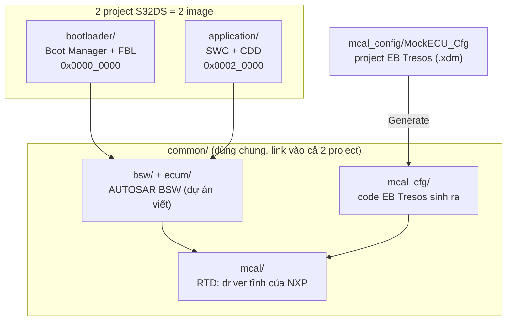
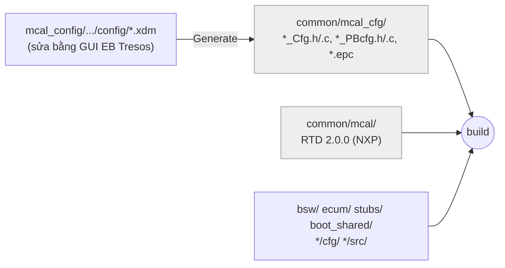
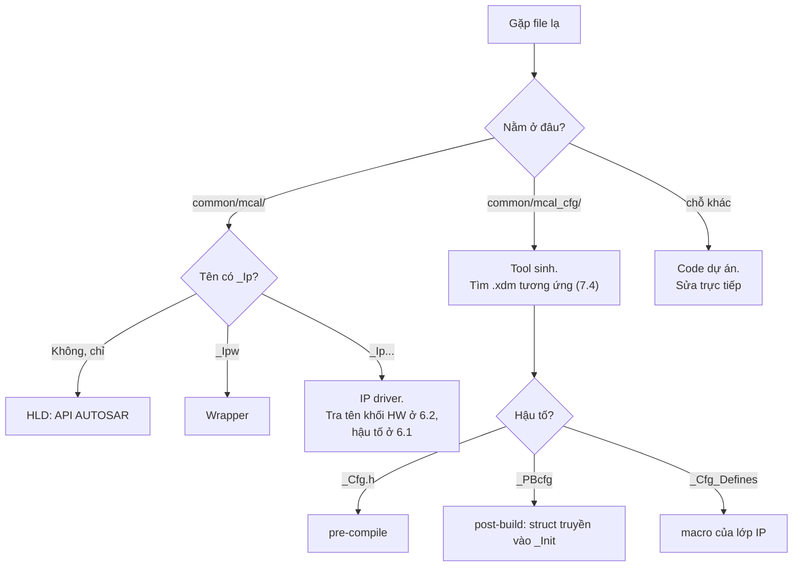

# 04 – Cấu trúc thư mục `firmware/` và quy ước tên file RTD / EB Tresos

> **Dành cho:** dev mới vào dự án. Bạn cần biết file nào ở đâu, file nào được sửa tay, file nào do tool sinh ra, và vì sao một driver như Mcu lại có tới 56 file.
> **Nên đọc trước:** [01_Setup_EB_Tresos.md](01_Setup_EB_Tresos.md), [02_MockECU_MCAL_Config.md](02_MockECU_MCAL_Config.md).
> **Đọc tiếp:** [03_Linker_Script_Bootloader.md](03_Linker_Script_Bootloader.md).

## Table of Contents

1. [Bức tranh tổng thể](#1-bức-tranh-tổng-thể)
2. [Cây thư mục `firmware/`](#2-cây-thư-mục-firmware)
3. [Bảng giải thích thư mục](#3-bảng-giải-thích-thư-mục)
4. [Ai sở hữu file nào: sửa tay hay tool sinh](#4-ai-sở-hữu-file-nào-sửa-tay-hay-tool-sinh)
5. [Kiến trúc 3 lớp của một driver RTD](#5-kiến-trúc-3-lớp-của-một-driver-rtd)
6. [Quy ước tên file RTD (code tĩnh)](#6-quy-ước-tên-file-rtd-code-tĩnh)
7. [Quy ước tên file EB Tresos sinh ra](#7-quy-ước-tên-file-eb-tresos-sinh-ra)
8. [Từng module RTD](#8-từng-module-rtd)
9. [Cách tra nhanh một file lạ](#9-cách-tra-nhanh-một-file-lạ)
10. [Cấu hình BSW: `bootloader/cfg` và `application/cfg`](#10-cấu-hình-bsw-bootloadercfg-và-applicationcfg)

---

## 1. Bức tranh tổng thể

Firmware có **2 image** chạy trên cùng một chip S32K144: Bootloader và Application. Hai image dùng chung phần lớn code, và phần chung này nằm trong `common/`:



Phần lớn file trong `firmware/` là của NXP, tức RTD và EB Tresos. **Phần dự án tự viết chỉ chiếm một phần nhỏ**: `bootloader/src`, `application/src`, `*/cfg`, `common/bsw`, `common/ecum`, `common/stubs`, `common/boot_shared`. Biết rõ ranh giới này là bước đầu tiên để không sửa nhầm file của NXP.

---

## 2. Cây thư mục `firmware/`

Cây dưới đây đã bỏ các thư mục build sinh ra (`Debug_FLASH/`, `Release_FLASH/`) và `.settings/`:

```
firmware/
├── bootloader/                    ← project S32DS #1 (image BL)
│   ├── .cproject, .project        cấu hình build S32DS
│   ├── .vscode/                   IntelliSense (gen_vscode.py sinh)
│   ├── Project_Settings/
│   │   ├── Debugger/              launch config để nạp/debug
│   │   └── Linker_Files/bl.ld     linker script
│   ├── cfg/                       cấu hình BSW cho BL (viết tay)
│   └── src/
│       ├── main.c
│       ├── boot_manager/          BM_*: quyết định ở lại BL hay nhảy sang App
│       └── fbl/                   Fbl_*: nạp phần mềm qua CAN (UDS)
│
├── application/                   ← project S32DS #2 (image App)
│   ├── .cproject, .project, .vscode/
│   ├── Project_Settings/{Debugger, Linker_Files/app.ld}
│   ├── cfg/                       cấu hình BSW cho App (viết tay)
│   └── src/
│       ├── main.c
│       ├── app/                   SWC giả, Dcm callout, AppVersion.h
│       └── cdd/CDD_CanTest/       Complex Device Driver test CAN
│
├── common/                        ← dùng chung (linked folder trong cả 2 project)
│   ├── .vscode/
│   ├── boot_shared/Boot_Shared.h  cờ boot App ↔ BL (.boot_noinit)
│   ├── bsw/                       AUTOSAR BSW (dự án viết theo SWS R24-11)
│   │   └── CanIf/ CanSM/ CanTp/ ComM/ Dcm/ Dem/ Det/ PduR/   (mỗi cái: include/ src/)
│   ├── ecum/                      EcuM + scheduler bare-metal (Os_Sched)
│   ├── stubs/                     SchM_<Bsw>.h (thay RTE/OS)
│   ├── mcal/                      RTD 2.0.0: code TĨNH của NXP
│   │   ├── Base/                  kiểu dữ liệu, Compiler, MemMap, OsIf, header thanh ghi
│   │   ├── Platform/              ngắt, MPU, startup, vector table
│   │   ├── Mcu/  Port/  Dio/  Gpt/  Can_43_FLEXCAN/  Mem_43_INFLS/  Spi/
│   │   └── Rte/                   SchM_<Mcal>.c/.h (vùng tới hạn)
│   └── mcal_cfg/                  code EB Tresos SINH RA (không sửa tay)
│       ├── include/  src/         *_Cfg.*, *_PBcfg.*
│       └── output/                *.epc (ECU config dạng AUTOSAR XML)
│
├── mcal_config/MockECU_Cfg/       ← project EB Tresos (nguồn của mcal_cfg/)
│   └── config/*.xdm               cấu hình từng module + SystemModel2.tdb
│
└── tests/{unit, target, stubs}/   ← chỗ dành cho test (hiện trống)
```

---

## 3. Bảng giải thích thư mục

### 3.1 Cấp project

| Thư mục | Nội dung | Ghi chú |
|---|---|---|
| `bootloader/` | Project S32DS của BL | Build ra `bootloader.elf` ở 0x0 |
| `application/` | Project S32DS của App | Build ra `application.elf` ở 0x20000 |
| `common/` | Code dùng chung | Không phải project; được **link** vào cả 2 project (`.project` → `<link>`) |
| `mcal_config/` | Project EB Tresos | Chỉ mở bằng EB Tresos. Không được build trực tiếp |
| `tests/` | Unit test, target test, stub | Hiện chưa có file |

### 3.2 Bên trong một project (lấy `bootloader/` làm ví dụ)

| Thư mục / file | Vai trò |
|---|---|
| `.cproject` | Cờ compiler/linker, include path, danh sách thư mục **loại khỏi build** (xem 3.4) |
| `.project` | Tên project, các linked folder trỏ tới `../common` |
| `Project_Settings/Linker_Files/` | `bl.ld` / `app.ld`. Xem guide 03 |
| `Project_Settings/Debugger/` | File `.launch` để nạp và debug (PEmicro/J-Link) |
| `cfg/` | Cấu hình **BSW** riêng cho từng image (`CanIf_PBcfg.c`, `Dcm_LCfg.c`…). Viết tay, vì không có công cụ cấu hình BSW. Chi tiết ở [mục 10](#10-cấu-hình-bsw-bootloadercfg-và-applicationcfg) |
| `src/boot_manager/` | `BM_Main` (quyết định), `BM_Request` (đọc cờ boot), `BM_Jump` (nhảy sang App) |
| `src/fbl/` | Flash Bootloader: `Fbl_Download`, `Fbl_Flash`, `Fbl_Crc32`, `Fbl_Metadata`, `Fbl_Routines`, `Dcm_Callout_Bl` |
| `src/app/` (App) | `DummySwc`, `Dcm_Callout_App`, `AppVersion.h` |
| `src/cdd/` (App) | `CDD_CanTest`: driver ngoài chuẩn AUTOSAR dùng để test CAN |

### 3.3 Bên trong `common/`

| Thư mục | Ai viết | Vai trò |
|---|---|---|
| `bsw/<Mod>/{include,src}` | Dự án | CanIf, CanSM, CanTp, ComM, Dcm, Dem, Det, PduR theo SWS R24-11 |
| `ecum/` | Dự án | `EcuM` (khởi tạo), `EcuM_Callout` (thứ tự init), `Os_Sched` (tick 1 ms / 10 ms) |
| `stubs/` | Dự án | `SchM_<Bsw>.h`: khai báo MainFunction, thay cho RTE/OS thật |
| `boot_shared/` | Dự án | `Boot_Shared.h`: struct 16 B dùng chung giữa App và BL |
| `mcal/` | **NXP (RTD)** | Driver tĩnh. Không sửa |
| `mcal_cfg/` | **EB Tresos** | Code sinh từ `.xdm`. Không sửa tay; sửa trong EB rồi Generate lại |

### 3.4 Thư mục có trong repo nhưng **không được build**

`.cproject` liệt kê các thư mục bị loại khỏi build. Một file nằm trong repo chưa chắc đã được compile.

| Bị loại | BL | App | Lý do |
|---|:-:|:-:|---|
| `mcal/Spi` | ✔ | ✔ | RTD có sẵn nhưng dự án không dùng SPI |
| `mcal/Platform/build_files` | ✔ | ✔ | Linker gốc của RTD (cho mọi chip); dự án dùng `bl.ld` / `app.ld` riêng |
| `startup/src/m0p`, `m4/ghs`, `m4/iar` | ✔ | ✔ | Startup cho lõi M0+ và cho trình biên dịch khác; S32K144 là M4, dùng GCC |
| `mcal_cfg/output` | ✔ | ✔ | Chỉ chứa file `.epc` (XML), không phải code |
| `bsw/Dem` | ✔ | | BL không lưu DTC |
| `mcal/Mem_43_INFLS` + `Mem_43_INFLS_Cfg.c`, `Ftfc_Mem_InFls_Ip_Cfg.c`, `SchM_Mem_43_INFLS.c` | | ✔ | Chỉ BL ghi flash; App không cần driver flash |

---

## 4. Ai sở hữu file nào: sửa tay hay tool sinh



| Loại | Thư mục | Muốn thay đổi thì |
|---|---|---|
| Code tĩnh của NXP | `common/mcal/` | **Không sửa.** Nâng phiên bản bằng cách chép bản RTD mới vào |
| Code sinh | `common/mcal_cfg/` | Sửa `.xdm` trong EB Tresos, rồi Generate (guide 02) |
| Code dự án | phần còn lại | Sửa trực tiếp |

> **Hay nhầm:** sửa tay file trong `mcal_cfg/` thì build vẫn chạy, nhưng **lần Generate sau sẽ ghi đè mất**. Luôn sửa từ `.xdm`.

---

## 5. Kiến trúc 3 lớp của một driver RTD

Đây là chìa khoá để hiểu mọi tên file. Mỗi driver RTD chia thành 3 lớp:

```
 ┌───────────────────────────────────────────────┐
 │ BSW / code dự án gọi: Mcu_Init(), Dio_Write.. │
 └───────────────────────┬───────────────────────┘
 ┌───────────────────────▼───────────────────────┐  Lớp 1 – HLD (High Level Driver)
 │  Mcu.c / Mcu.h                                │  API đúng chuẩn AUTOSAR SWS,
 │  kiểm tra tham số, báo lỗi Det/Dem            │  không chạm thanh ghi
 └───────────────────────┬───────────────────────┘
 ┌───────────────────────▼───────────────────────┐  Lớp 2 – Ipw (IP Wrapper)
 │  Mcu_Ipw.c / Mcu_Ipw.h                        │  "bộ chuyển": 1 API AUTOSAR
 │  định tuyến tới 1 hoặc nhiều IP bên dưới      │  → gọi các IP phù hợp
 └──────┬──────────────┬──────────────┬──────────┘
 ┌──────▼─────┐ ┌──────▼─────┐ ┌──────▼─────┐      Lớp 3 – IP (IP Driver / IPL)
 │ Clock_Ip   │ │ Power_Ip   │ │ Ram_Ip     │      driver cho TỪNG khối phần cứng,
 │ (SCG, PCC) │ │ (PMC, SMC, │ │ (SRAM init)│      chạm thanh ghi trực tiếp,
 │            │ │  RCM, SIM) │ │            │      dùng được cả khi không AUTOSAR
 └────────────┘ └────────────┘ └────────────┘
```

**Vì sao phải tách nhiều lớp như vậy?**

1. **Một API AUTOSAR thường dùng tới nhiều khối phần cứng.** Ví dụ `Mcu_Init` vừa đặt clock (SCG), vừa đặt power (PMC/SMC), vừa đọc nguyên nhân reset (RCM). Mỗi khối có một IP riêng.
2. **Dùng lại giữa nhiều chip.** Cùng một IP, ví dụ `FlexCAN_Ip`, được dùng cho S32K1, S32K3, S32G. NXP chỉ phải viết lại phần khác nhau.
3. **Dùng được khi không có AUTOSAR.** Lớp IP có API riêng và được gọi thẳng (lớp "IPL" trong RTD). Nhiều ví dụ bare-metal của NXP chỉ dùng lớp này.
4. **Một API ↔ nhiều lựa chọn phần cứng.** `Gpt` có thể chạy trên FTM, LPIT, LPTMR hoặc RTC. Lớp Ipw chọn IP theo cấu hình của từng kênh.

---

## 6. Quy ước tên file RTD (code tĩnh)

### 6.1 Bảng hậu tố và tiền tố

Ký hiệu: `<Mod>` = tên module AUTOSAR (Mcu, Gpt…); `<Ip>` = tên khối phần cứng (FlexCAN, Ftm, Clock…).

| Mẫu tên | Lớp | Ý nghĩa | Ví dụ |
|---|---|---|---|
| `<Mod>.c/.h` | HLD | API AUTOSAR công khai | `Mcu.c`, `Dio.h` |
| `<Mod>_Ipw.c/.h` | Ipw | Wrapper nối HLD với các IP | `Mcu_Ipw.c` |
| `<Mod>_Ipw_Types.h` | Ipw | Kiểu dữ liệu của lớp wrapper | `Gpt_Ipw_Types.h` |
| `<Mod>_Ipw_Irq.c/.h` | Ipw | Hàm ngắt ở mức wrapper, gọi lên callback AUTOSAR | `Mcu_Ipw_Irq.c` |
| `<Ip>_Ip.c/.h` | IP | Driver của một khối phần cứng | `FlexCAN_Ip.c`, `Clock_Ip.c` |
| `<Ip>_<Mod>_Ip.*` | IP | IP dùng cho một module cụ thể (khi khối HW được nhiều module dùng) | `Ftm_Gpt_Ip.c` (FTM dùng làm timer), `Gpio_Dio_Ip.c` |
| `<Ip>_Ip_Types.h` / `_TypesDef.h` | IP | Kiểu dữ liệu, struct cấu hình của IP | `FlexCAN_Ip_Types.h` |
| `<Ip>_Ip_Irq.c/.h` | IP | Trình phục vụ ngắt (ISR) của khối HW | `FlexCAN_Ip_Irq.c` |
| `<Ip>_Ip_HwAccess.c/.h` | IP | Hàm đọc/ghi thanh ghi mức thấp nhất | `FlexCAN_Ip_HwAccess.c` |
| `<Ip>_Ip_DeviceReg(isters).h` | IP | Ánh xạ thanh ghi riêng của IP | `IntCtrl_Ip_DeviceRegisters.h` |
| `<Ip>_Ip_Private.c/.h` | IP | Hàm nội bộ, không phải API | `Clock_Ip_Private.h`, `Power_Ip_Private.c` |
| `<Ip>_Ip_Specific.c/.h` | IP | Phần **riêng cho dòng chip** (S32K1), tách khỏi phần chung | `Clock_Ip_Specific.c` |
| `<Ip>_Ip_Data.c` | IP | Bảng dữ liệu hằng (bảng clock, bảng hàm callback) | `Clock_Ip_Data.c` |
| `<Ip>_Ip_TrustedFunctions.h` | IP | Hàm phải chạy ở chế độ đặc quyền (*User Mode support*) | `Power_Ip_TrustedFunctions.h` |
| `<Ip>_Ip_Wrapper.h` | IP | Lớp tương thích tên API cũ | `FlexCAN_Ip_Wrapper.h` |
| `<Ip>_Ip_Ac.c/.h` | IP | **Access Code**: code ghi flash phải chạy từ RAM | `Ftfc_Mem_InFls_Ip_Ac.c` |
| `<Mod>_Irq.c/.h` | HLD | ISR do HLD đăng ký | `Can_43_FLEXCAN_Irq.c` |
| `<Mod>_EnvCfg.h` | HLD | Tự suy ra macro kiểm tra từ cấu hình (ví dụ `MCU_PARAM_CHECK` = `MCU_DEV_ERROR_DETECT`) | `Mcu_EnvCfg.h` |
| `<Mod>_Dem_Wrapper.c/.h` | HLD | Gói việc báo lỗi phần cứng sang Dem, để tắt Dem thì không cần sửa driver | `Mcu_Dem_Wrapper.c` |
| `<Mod>_Types.h` | HLD | Kiểu dữ liệu AUTOSAR của module | `Mem_43_INFLS_Types.h` |
| `<Mod>_43_<HW>` | HLD | Tên **có vendor ID** (NXP = 43) và tên phần cứng. Cho phép nhiều driver cùng loại chạy chung một ECU | `Can_43_FLEXCAN`, `Mem_43_INFLS` |
| `SchM_<Mod>.c/.h` | Rte | Vào/ra vùng tới hạn (exclusive area) của driver | `SchM_Dio.c` |
| `<Mod>_MemMap.h` | Base | Map code/biến của module vào section (`.mcal_text`…) | `Dio_MemMap.h` |

### 6.2 Giải nghĩa các tên khối phần cứng hay gặp

Các tên này **không phải tên AUTOSAR**. Đó là tên khối ngoại vi trong Reference Manual của S32K144.

| Tên trong file | Khối phần cứng | Dùng trong module |
|---|---|---|
| `SCG` (trong `Clock_Ip_*`) | System Clock Generator: FIRC, SIRC, SOSC, SPLL | Mcu |
| `PCC` (trong `Clock_Ip_Gate`) | Peripheral Clock Control: bật/tắt clock cho từng ngoại vi | Mcu |
| `PMC` | Power Management Controller: LVD, regulator | Mcu (`Power_Ip_PMC`) |
| `SMC` | System Mode Controller: RUN, VLPR, HSRUN, STOP | Mcu (`Power_Ip_SMC`) |
| `RCM` | Reset Control Module: nguyên nhân reset, phát reset | Mcu (`Power_Ip_RCM`). Boot Manager đọc `RCM->SRS` |
| `SIM` | System Integration Module: chip ID, cấu hình hệ thống, clock out | Mcu (`Power_Ip_SIM`) |
| `CortexM4` | Thanh ghi lõi SCB (sleep, reset hệ thống `SYSRESETREQ`) | Mcu (`Power_Ip_CortexM4`) |
| `AEC` | Khối analog mở rộng **trên dòng S32M24x**. S32K144 không có; `POWER_IP_AECRESETCONFIG_API = STD_OFF` | Mcu (`Power_Ip_AEC`, file có nhưng không dùng) |
| `PORT` (`Port_Ci_Port_Ip`) | Mux chân, pull, ngắt chân. `Ci` là tên dòng IP PORT của NXP | Port |
| `GPIO` (`Gpio_Dio_Ip`) | Đọc/ghi mức logic của chân | Dio |
| `FTM` | FlexTimer | Gpt |
| `LPIT` | Low Power Interrupt Timer | Gpt |
| `LPTMR` | Low Power Timer | Gpt |
| `SRtc` | Real Time Clock | Gpt |
| `FlexCAN` | Bộ điều khiển CAN | Can_43_FLEXCAN |
| `FTFC` (`Ftfc_Mem_InFls_Ip`) | Flash memory controller (P-Flash, D-Flash) | Mem_43_INFLS |
| `InFls` | *Internal Flash* | Mem_43_INFLS |
| `IntCtrl` | NVIC: bật, tắt, ưu tiên ngắt | Platform |
| `Mpu` | Memory Protection Unit | Platform |
| `System_Ip` | Thanh ghi hệ thống mức nền (MSCM…) | Platform |
| `LPSPI`, `Flexio_Spi` | SPI thường / SPI mô phỏng bằng FlexIO | Spi (không build) |

### 6.3 Vì sao Mcu có tới 56 file?

```
Mcu (HLD)          Mcu.c  Mcu.h  Mcu_EnvCfg.h  Mcu_Dem_Wrapper.*
  └─ Mcu_Ipw       Mcu_Ipw.*  Mcu_Ipw_Irq.c  Mcu_Ipw_Types.h
       ├─ Clock_Ip   Clock_Ip.c  Clock_Ip.h  Clock_Ip_Types.h  Clock_Ip_Private.h
       │             + một file cho MỖI loại "phần tử clock":
       │             IntOsc (FIRC/SIRC)   ExtOsc (SOSC)   Pll (SPLL)
       │             Selector (mux)       Divider         DividerTrigger
       │             FracDiv              Gate (PCC)      Monitor (CMU)
       │             Frequency (tính tần số)   ProgFreqSwitch   Irq
       │             Specific (riêng S32K1)    Data (bảng)
       ├─ Power_Ip   Power_Ip.c + một file cho MỖI khối HW:
       │             PMC  SMC  RCM  SIM  AEC  CortexM4  Private  (+ _Types, _Irq)
       └─ Ram_Ip     Ram_Ip.c  Ram_Ip.h  Ram_Ip_Types.h
```

Lý do là RTD mô hình hoá cây clock thành các **phần tử** (dao động, chọn nguồn, chia tần, cổng), mỗi loại một file. Một chip mới chỉ cần ghép lại các phần tử qua `Clock_Ip_Data.c` và `Clock_Ip_Specific.c`, không phải viết lại driver. Power cũng vậy: mỗi khối HW một file. Nhiều file như vậy là **để tái sử dụng giữa các chip**, không phải vì S32K144 phức tạp.

---

## 7. Quy ước tên file EB Tresos sinh ra

### 7.1 Ba thời điểm cấu hình (Configuration Class) của AUTOSAR

Mọi tên file sinh ra đều xoay quanh câu hỏi: **tham số này được cố định lúc nào?**

| Lớp cấu hình | Cố định lúc | File sinh ra | Nội dung điển hình |
|---|---|---|---|
| **Pre-compile** | Lúc compile (macro) | `<X>_Cfg.h` (+ `<X>_Cfg.c`) | `#define MCU_DEV_ERROR_DETECT STD_ON`, số kênh, bật/tắt API |
| **Link-time** | Lúc link (hằng có địa chỉ) | `<X>_Cfg.c`, `_LCfg.c` | Bảng hằng không đổi giữa các biến thể |
| **Post-build** | Sau khi build, **có thể thay được** | `<X>_PBcfg.c/.h` | Struct cấu hình (`Mcu_Config`, `Port_Config`) được truyền vào `<Mod>_Init(&Config)` |

Dự án đặt `IMPLEMENTATION-CONFIG-VARIANT = VARIANT-POST-BUILD` (xem `Mcu.epc`) và `MCU/PORT/GPT_PRECOMPILE_SUPPORT = STD_OFF`. Vì vậy code phải gọi `Mcu_Init(&Mcu_Config)` và truyền con trỏ cấu hình, như trong `Test_LedBlink`.

### 7.2 Bảng hậu tố của file sinh ra

| Mẫu tên | Ý nghĩa | Ví dụ |
|---|---|---|
| `<X>_Cfg.h` | Macro pre-compile: bật/tắt tính năng, ID kênh, symbolic name | `Dio_Cfg.h` (`DioConf_DioChannel_LED_RED`) |
| `<X>_Cfg.c` | Dữ liệu cấu hình pre-compile/link-time | `Port_Cfg.c` |
| `<X>_PBcfg.c/.h` | Struct cấu hình post-build | `Mcu_PBcfg.c` (`Mcu_Config`), `Port_PBcfg.c` (`Port_Config`) |
| `<X>_Cfg_Defines.h` / `_CfgDefines.h` | Macro cấu hình **của lớp IP** (thường là danh sách tính năng phần cứng được bật) | `Power_Ip_Cfg_Defines.h`, `Clock_Ip_Cfg_Defines.h` |
| `<Ip>_Ip_Cfg.*` / `<Ip>_Ip_PBcfg.*` | Cấu hình cho **lớp IP** (song song với cấu hình HLD) | `FlexCAN_Ip_PBcfg.c`, `Clock_Ip_PBcfg.c` |
| `<Mod>_Ipw_Cfg.*` / `_Ipw_PBcfg.*` | Cấu hình cho lớp Ipw: kênh AUTOSAR nào map sang IP nào | `Gpt_Ipw_PBcfg.c`, `Can_43_FLEXCAN_Ipw_PBcfg.c` |
| `<Ip>_Ip_Defines.h` | Hằng số rút ra từ cấu hình, cho IP dùng | `Port_Ci_Port_Ip_Defines.h` |
| `<Mod>_Externals.h` | Khai báo callback do người dùng viết mà driver sẽ gọi | `Can_43_FLEXCAN_Externals.h` |
| `Soc_Ips.h` | Khai báo IP nào có trên SoC đang chọn | — |
| `modules.h` | Danh sách module MCAL được bật (`USE_<MOD>_MODULE`, ví dụ `USE_CAN_43_FLEXCAN_MODULE = STD_ON`) | — |
| `OsIf_Cfg.*`, `OsIf_ArchCfg.h` | Cấu hình lớp OS-interface (timer hệ thống, có OS hay không) | — |
| `EcuM_Cfg.h` | Phần EcuM tối thiểu mà MCAL cần (wakeup source) | — |
| `output/*.epc` | Bản xuất cấu hình dạng **AUTOSAR XML (ECUC values)**, dùng để trao đổi với tool khác | `Mcu.epc` |

### 7.3 Vì sao một module sinh ra nhiều file như vậy?

Lấy **Gpt** làm ví dụ: 13 file cấu hình cho một bộ timer.

```
Gpt_Cfg.h / Gpt_Cfg.c              ← HLD, pre-compile (bật API, số kênh)
Gpt_PBcfg.h / Gpt_PBcfg.c          ← HLD, post-build (Gpt_Config: danh sách kênh)
Gpt_Ipw_PBcfg.h / .c               ← Ipw: kênh GptChannel_Tick1ms → LPIT0 kênh 0
Ftm_Gpt_Ip_Cfg.h / _Cfg_Defines.h / _PBcfg.*    ← IP FTM
LPit_Gpt_Ip_Cfg.h / _Cfg_Defines.h / _PBcfg.*   ← IP LPIT
Lptmr_Gpt_Ip_Cfg.h / _Cfg_Defines.h / _PBcfg.*  ← IP LPTMR
SRtc_Ip_Cfg.h / _Cfg_Defines.h / _PBcfg.*       ← IP RTC
```

Quy luật: **(số lớp: HLD, Ipw, IP) × (số IP mà module hỗ trợ) × (pre-compile .h + post-build .c/.h)**. Kể cả IP không dùng cũng sinh file, với nội dung rỗng hoặc "tắt", để code tĩnh luôn tìm thấy header nó `#include`.

### 7.4 Ánh xạ file `.xdm` → file sinh ra

| `config/*.xdm` (EB Tresos) | Sinh ra trong `mcal_cfg/` |
|---|---|
| `Mcu.xdm` | `Mcu_*`, `Clock_Ip_*`, `Power_Ip_*`, `Ram_Ip_*` |
| `Port.xdm` | `Port_*`, `Port_Ci_Port_Ip_*` |
| `Dio.xdm` | `Dio_*`, `Gpio_Dio_Ip_*` |
| `Gpt.xdm` | `Gpt_*`, `Ftm_/LPit_/Lptmr_Gpt_Ip_*`, `SRtc_Ip_*` |
| `Can_43_FLEXCAN.xdm` | `Can_43_FLEXCAN_*`, `FlexCAN_Ip_*` |
| `Mem_43_INFLS.xdm` | `Mem_43_INFLS_*`, `Ftfc_Mem_InFls_Ip_*` |
| `Platform.xdm` | `Platform_*`, `IntCtrl_Ip_*`, `Mpu_Ip_*`, `System_Ip_*` |
| `BaseNXP.xdm` | `OsIf_*`, `modules.h`, `Soc_Ips.h` |
| `EcuM.xdm` | `EcuM_Cfg.h` |
| `Resource.xdm` | Chọn chip (S32K144, gói chân) cho mọi module |

---

## 8. Từng module RTD

Mỗi module được trình bày cùng một khung: **vai trò → các lớp file → cấu hình sinh ra → dự án dùng gì**.

### 8.1 Base (nền tảng chung)

| Nhóm file | Vai trò |
|---|---|
| `Std_Types.h`, `StandardTypes.h`, `Platform_Types.h`, `PlatformTypes.h`, `BasicTypes.h` | Kiểu chuẩn AUTOSAR (`uint8`, `Std_ReturnType`, `STD_ON`…) |
| `Compiler.h`, `Compiler_Cfg.h`, `CompilerDefinition.h` | Macro theo từng compiler (`FUNC`, `P2VAR`, `INLINE`) |
| `ComStack_Types.h`, `Can_GeneralTypes.h`… | Kiểu dùng chung của stack truyền thông (`PduInfoType`, `Can_PduType`) |
| `<Mod>_MemMap.h` (rất nhiều) | Gán section bộ nhớ (guide 03, chương 3.2). Có cho **mọi** module NXP, kể cả module không dùng |
| `OsIf*` | Lớp trừu tượng OS: timer (SysTick), ngắt, tính timeout. Bare-metal thì dùng `OsIf_Timer_System` |
| `Mcal.h`, `Devassert.h`, `RegLockMacros.h`, `Reg_eSys.h`, `IpVersionMacros.h` | Macro hạ tầng: assert, khoá thanh ghi, kiểm tra phiên bản |
| `header/S32K144_<PERIPH>.h`, `S32K144.h`, `*.svd` | Định nghĩa thanh ghi ngoại vi (struct + mask). Có cho mọi chip (`S32K116`… `S32M24x`), dự án chỉ dùng `S32K144*` |

### 8.2 Platform (ngắt, MPU, khởi động)

| Lớp | File | Vai trò |
|---|---|---|
| HLD | `Platform.c/.h` | API `Platform_Init`, `Platform_InstallIrqHandler` |
| Ipw | `Platform_Ipw.*` | Gọi IntCtrl, Mpu, System |
| IP | `IntCtrl_Ip.*` (NVIC), `Mpu_Ip.*`, `System_Ip.*` | Thanh ghi trực tiếp |
| Startup | `startup_cm4.s`, `Vector_Table.s`, `startup.c`, `system.c`, `sys_init.c`, `nvic.c`, `exceptions.c` | Reset → RamInit → copy data → `main` (guide 03, chương 8) |
| Cấu hình | `Platform_Cfg.*`, `Platform_Ipw_Cfg.*`, `IntCtrl_Ip_Cfg.*`, `Mpu_Ip_Cfg.*`, `System_Ip_Cfg.h` | Danh sách ngắt được bật, độ ưu tiên |

### 8.3 Mcu (clock, power, reset, RAM)

| Lớp | File |
|---|---|
| HLD | `Mcu.*`, `Mcu_EnvCfg.h`, `Mcu_Dem_Wrapper.*` |
| Ipw | `Mcu_Ipw.*`, `Mcu_Ipw_Irq.c`, `Mcu_Ipw_Types.h` |
| IP | `Clock_Ip_*` (cây clock), `Power_Ip_*` (PMC/SMC/RCM/SIM/AEC/CortexM4), `Ram_Ip_*` |
| Cấu hình | `Mcu_Cfg.*`, `Mcu_PBcfg.*`, `Clock_Ip_Cfg*`, `Clock_Ip_PBcfg.*`, `Power_Ip_Cfg*`, `Power_Ip_PBcfg.*`, `Ram_Ip_Cfg*`, `Ram_Ip_PBcfg.*` |

**Dự án dùng:** `Mcu_Init(&Mcu_Config)`, `Mcu_InitClock(McuClockSettingConfig_0)` (FIRC 48 MHz), `Mcu_SetMode`, `Mcu_PerformReset` (EcuM), và đọc nguyên nhân reset để Boot Manager xử lý.

### 8.4 Port (cấu hình chân)

| Lớp | File |
|---|---|
| HLD | `Port.*` |
| Ipw | `Port_Ipw.*` |
| IP | `Port_Ci_Port_Ip.*` (+ `_Types`, `_TrustedFunctions`) |
| Cấu hình | `Port_Cfg.*`, `Port_PBcfg.*`, `Port_Ci_Port_Ip_Cfg.h`, `Port_Ci_Port_Ip_PBcfg.c`, `Port_Ci_Port_Ip_Defines.h` |

**Dự án dùng:** `Port_Init(&Port_Config)` để mux 5 chân: `LED_BLUE_PTD0`, `LED_RED_PTD15`, `LED_GREEN_PTD16`, `CAN0_RX_PTE4`, `CAN0_TX_PTE5` (tên symbolic nằm trong `Port_Cfg.h`).

### 8.5 Dio (đọc/ghi chân)

Đây là module nhỏ nhất, có đủ 3 lớp mà chỉ gồm 6 file. Nên đọc module này đầu tiên để làm quen với mô hình lớp.

| Lớp | File |
|---|---|
| HLD | `Dio.*` |
| Ipw | `Dio_Ipw.*` |
| IP | `Gpio_Dio_Ip.*` |
| Cấu hình | `Dio_Cfg.*`, `Gpio_Dio_Ip_Cfg.h` |

**Dự án dùng:** `Dio_FlipChannel(DioConf_DioChannel_LED_RED)` và `Dio_WriteChannel`.

### 8.6 Gpt (timer)

| Lớp | File |
|---|---|
| HLD | `Gpt.*`, `Gpt_EnvCfg.h`, `Gpt_Irq.h` |
| Ipw | `Gpt_Ipw.*`, `Gpt_Ipw_Irq.h`, `Gpt_Ipw_Types.h` |
| IP (4 lựa chọn) | `Ftm_Gpt_Ip.*`, `LPit_Gpt_Ip.*`, `Lptmr_Gpt_Ip.*`, `SRtc_Ip.*` |
| Cấu hình | xem 7.3 |

**Dự án dùng:** một kênh `GptChannel_Tick1ms` chạy trên **LPIT0** (`Gpt_Ipw_PBcfg.c`: `GPT_LPIT_MODULE`), có notification gọi `Os_Sched_TickNotification`. Các IP FTM, LPTMR, RTC vẫn sinh file cấu hình nhưng không được dùng.

### 8.7 Can_43_FLEXCAN (CAN)

| Lớp | File |
|---|---|
| HLD | `Can_43_FLEXCAN.*`, `Can_43_FLEXCAN_Irq.*`, `Can_Flexcan_Types.h` |
| Ipw | `Can_43_FLEXCAN_Ipw.*`, `_Ipw_Irq.h`, `_Ipw_Types.h` |
| IP | `FlexCAN_Ip.*`, `_HwAccess.*`, `_Irq.*`, `_DeviceReg.h`, `_Types.h`, `_Wrapper.h`, `_TrustedFunctions.h` |
| Cấu hình | `Can_43_FLEXCAN_Cfg.h`, `_PBcfg.*`, `_Ipw_Cfg.h`, `_Ipw_PBcfg.*`, `_Externals.h`, `FlexCAN_Ip_Cfg.h`, `_CfgDefines.h`, `_PBcfg.*` |

**Vì sao tên có `_43_FLEXCAN`?** Theo AUTOSAR, khi một ECU có nhiều driver CAN (ví dụ FlexCAN trên chip và một CAN controller ngoài qua SPI), tên API phải khác nhau. Vì vậy tên module là `Can_<VendorId>_<VendorApiInfix>`, và API là `Can_43_FLEXCAN_Write`. CanIf gọi các API này qua bảng hàm.

**Dự án dùng:** CAN0 500 kbit/s trên PTE4 (RX) / PTE5 (TX). TX, RX và bus-off chạy bằng **ngắt** (`CAN_43_FLEXCAN_TX/RX/BUSOFF_POLLING_SUPPORT = STD_OFF` trong `Can_43_FLEXCAN_Cfg.h`). `Can_43_FLEXCAN_MainFunction_Mode` vẫn được gọi định kỳ để theo dõi chuyển trạng thái controller.

### 8.8 Mem_43_INFLS (ghi flash nội, chỉ BL dùng)

| Lớp | File |
|---|---|
| HLD | `Mem_43_INFLS.*`, `Mem_43_INFLS_Types.h` |
| Ipw | `Mem_43_INFLS_Ipw.*` |
| IP | `Ftfc_Mem_InFls_Ip.*`, `Ftfc_Mem_InFls_Ip_Ac.*` (**access code chạy từ RAM**) |
| Cấu hình | `Mem_43_INFLS_Cfg.*`, `_CfgDefines.h`, `Ftfc_Mem_InFls_Ip_Cfg.*` |

`_Ac` chính là phần code được linker gom vào `.acmem_43_INFLS_code_rom` rồi copy ra `.acfls_code_ram` (guide 03, chương 7.3). Lý do: trong lúc flash đang bị xoá hoặc ghi, CPU không lấy lệnh từ flash được.

**Dự án dùng:** FBL dùng module này để xoá và ghi vùng App (0x20000–0x7EFFF) và metadata. App loại module này khỏi build (3.4).

### 8.9 Rte (vùng tới hạn của MCAL)

`SchM_<Mod>.c/.h` cung cấp `SchM_Enter_<Mod>_EXCLUSIVE_AREA_xx()` / `SchM_Exit_...`. Trên hệ thống có OS, RTE thật sẽ sinh các hàm này. Ở đây không có OS, nên RTD đưa sẵn bản mặc định (tắt/bật ngắt toàn cục).

> Đừng nhầm `common/mcal/Rte/` (SchM cho **MCAL**, của NXP) với `common/stubs/` (SchM cho **BSW**, do dự án viết).

### 8.10 Spi (có sẵn nhưng không dùng)

`Spi.*`, `Spi_Ipw.*`, `Lpspi_Ip.*`, `Flexio_Spi_Ip.*`. Toàn bộ thư mục bị loại khỏi build (3.4). Thư mục được giữ lại vì nó nằm trong gói RTD và để dùng nếu sau này cần SPI.

---

## 9. Cách tra nhanh một file lạ



**Ví dụ:** `Power_Ip_RCM_Irq.c`

| Phần tên | Nghĩa |
|---|---|
| `Power_Ip` | IP Power, thuộc module Mcu |
| `RCM` | Khối Reset Control Module |
| `_Irq` | Hàm phục vụ ngắt của khối đó |

Vậy đây là ISR của RCM, nằm trong `common/mcal/Mcu/src/`, là file tĩnh của NXP và không sửa.

---

## 10. Cấu hình BSW: `bootloader/cfg` và `application/cfg`

### 10.1 Vì sao cấu hình BSW nằm trong từng project, không nằm trong `common/`?

Code BSW (`common/bsw/CanIf/src/CanIf.c`…) **dùng chung** cho cả hai image. Nhưng mỗi image cần cấu hình khác nhau: BL cần buffer Dcm lớn để nhận khối dữ liệu flash, còn App cần Dem để lưu DTC. Cách giải quyết dựa vào include path:

```
common/bsw/CanIf/include/CanIf.h
    #include "CanIf_Cfg.h"          ← cùng một tên file
             │
             ├── build bootloader  → include path ${ProjDirPath}/cfg → bootloader/cfg/CanIf_Cfg.h
             └── build application → include path ${ProjDirPath}/cfg → application/cfg/CanIf_Cfg.h
```

Mỗi `.cproject` thêm `${ProjDirPath}/cfg` vào include path. Các file `.c` trong `cfg/` cũng chỉ được compile trong project của chính nó. Kết quả là **một mã nguồn BSW, hai bộ cấu hình**.

> Đây là việc EB Tresos làm cho MCAL (`mcal_cfg/`). Với BSW, dự án không có công cụ cấu hình, nên các file này **viết tay** theo đúng quy ước tên của AUTOSAR.

### 10.2 Quy ước tên file

Quy ước này giống mục 7.1, nhưng tên file tuân theo tên mà SWS của từng module quy định:

| Hậu tố | Lớp cấu hình | Nội dung | Module dùng |
|---|---|---|---|
| `<Mod>_Cfg.h` | Pre-compile | `#define` bật/tắt tính năng, chu kỳ MainFunction, symbolic name (`ComMConf_…`, `DemConf_…`), khai báo `extern` struct cấu hình | Tất cả |
| `<Mod>_PBcfg.c` | Post-build | Định nghĩa struct cấu hình truyền vào `<Mod>_Init(&<Mod>_Config)` | CanIf, PduR |
| `<Mod>_Cfg.c` | Pre-compile / link-time | Như trên, với module mà SWS không yêu cầu post-build | CanSM, CanTp, ComM, Det |
| `<Mod>_LCfg.c` | Link-time | Bảng hằng không đổi sau khi link (bảng service, bảng DID/DTC) | Dcm, Dem |

Struct cấu hình trong file `.c` luôn có tên `<Mod>_Config`, ví dụ `CanIf_Config` hoặc `Dcm_Config`. `EcuM_AL_DriverInitOne` truyền struct này vào hàm `Init` (ECUM_SRS_001).

### 10.3 Từng file

**Trạng thái hiện tại:** mọi file `.c` mới là **khung**, có dạng `const <Mod>_ConfigType <Mod>_Config = { 0U /* TODO(<task>) */ };`. Nội dung thật sẽ được viết trên nhánh feature của từng task (mã task có trong comment `TODO`). Các file `.h` đã có các tham số chốt từ `docs/Mock.docx`.

| File | Nội dung chính (đã có) | Hoàn thiện ở task |
|---|---|---|
| `CanIf_Cfg.h` | `CANIF_DEV_ERROR_DETECT`, `CANIF_VERSION_INFO_API`, `CANIF_PRIVATE_DATA_LENGTH_CHECK = STD_ON` (SWS_CANIF_00168) | — |
| `CanIf_PBcfg.c` | `CanIf_Config`: bảng CAN ID ↔ L-PDU, HRH/HTH, PDU nào đi lên CanTp | C-03 |
| `PduR_Cfg.h` | `PDUR_DEV_ERROR_DETECT` | — |
| `PduR_PBcfg.c` | `PduR_Config`: bảng định tuyến PDU giữa CanTp ↔ Dcm | T-05 |
| `CanTp_Cfg.h` | `CANTP_MAIN_FUNCTION_PERIOD_MS = 1`, `CANTP_PADDING_BYTE = 0xAA` | — |
| `CanTp_Cfg.c` | `CanTp_Config`: kênh N-SDU (vật lý/chức năng), STmin, BS, timeout N_As/N_Bs/N_Cr | T-04 |
| `CanSM_Cfg.h` | Chu kỳ 10 ms; khôi phục bus-off: L1 = 10 ms, 5 lần chuyển L2, L2 = 1000 ms; `CANSM_DEM_EVENT_BUS_OFF_ENABLED` | — |
| `CanSM_Cfg.c` | `CanSM_Config`: mạng CAN0 ↔ controller ↔ kênh ComM | B-04 (BL), X-01 (App) |
| `ComM_Cfg.h` | Chu kỳ 10 ms, `ComMConf_ComMChannel_CAN0 = 0`, `ComMConf_ComMUser_Diag = 0` | — |
| `ComM_Cfg.c` | `ComM_Config`: kênh, user, chế độ | B-04 (BL), X-02 (App) |
| `Dcm_Cfg.h` | Chu kỳ 10 ms, `DCM_DSL_BUFFER_SIZE`, P2 = 50 ms, P2* = 5000 ms, S3 = 5000 ms, `DCM_SEC_LEVEL_IMAGE` | — |
| `Dcm_LCfg.c` | `Dcm_Config`: bảng service UDS, session, security, DID, routine | B-04 (BL), X-07…X-10 (App) |
| `Det_Cfg.h` / `Det_Cfg.c` | Chỉ có `extern` / định nghĩa `Det_Config` | D-01/D-02 |
| `Dem_Cfg.h` *(App)* | 2 event: `CANSM_E_BUS_OFF` (DTC 0xC07300), `DUMMY_TEST` (DTC 0x9A0113); operation cycle POWER; client Dcm | — |
| `Dem_LCfg.c` *(App)* | `Dem_Config`: bảng event ↔ DTC, debounce, snapshot | M-02 |

Hai cách bật/tắt kiểm tra lỗi phát triển:

```c
#if defined(DET_ENABLED)          /* .cproject định nghĩa ở Debug_FLASH */
#define CANIF_DEV_ERROR_DETECT  (STD_ON)
#else                             /* Release_FLASH */
#define CANIF_DEV_ERROR_DETECT  (STD_OFF)
#endif
```

Mọi file `<Mod>_Cfg.h` đều dùng mẫu này, nên Debug báo lỗi qua Det còn Release thì bỏ hết phần kiểm tra.

### 10.4 BL khác App ở đâu

Hai thư mục có **cùng tên file** (trừ Dem). Phần lớn file chỉ khác dòng `@brief` (BOOTLOADER / APPLICATION) và mã task trong `TODO`. Những khác biệt **có giá trị thật**:

| Tham số / file | Bootloader | Application | Lý do |
|---|---|---|---|
| `Dem_Cfg.h`, `Dem_LCfg.c` | **Không có** (`bsw/Dem` bị loại khỏi build) | Có | Chỉ App lưu và báo DTC |
| `CANSM_DEM_EVENT_BUS_OFF_ENABLED` | `STD_OFF` | `STD_ON` | BL không có Dem để báo bus-off |
| `DCM_DSL_BUFFER_SIZE` | **1026** | 256 | `Mock.docx`: BL nhận `36 <BSC> <data ≤ 1024>` = 1024 B data + 1 B SID + 1 B block counter |
| `DCM_SEC_LEVEL_IMAGE` | `0x11` | `0x01` | `Mock.docx`: App mở level 01 (`27 01`/`27 02`) trong Extended session; BL mở level 11 (`27 11`/`27 12`) trong Programming session |
| Bảng service trong `Dcm_LCfg.c` | Session Default/Programming, service nạp flash (0x34/0x36/0x37, routine xoá/kiểm tra) | Session Default/Extended, service chẩn đoán (DID, DTC); nhận `10 02` thì ghi cờ boot và reset về BL | `Mock.docx` mục bảng UDS. Hoàn thiện ở B-04 / X-07…X-10 |

> **Khi sửa:** tham số chung cho cả hai image (ví dụ chu kỳ, padding CanTp) phải sửa **ở cả hai thư mục**. Tham số riêng thì chỉ sửa ở image cần. Sau khi sửa, build cả hai project: `bash software/tools/build.sh all all`.
